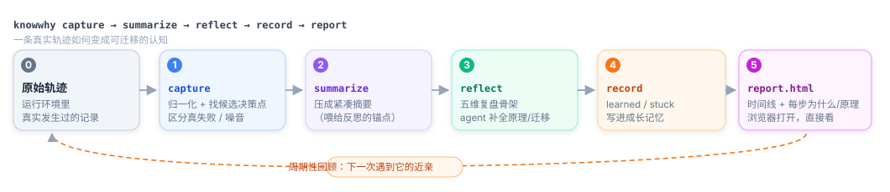
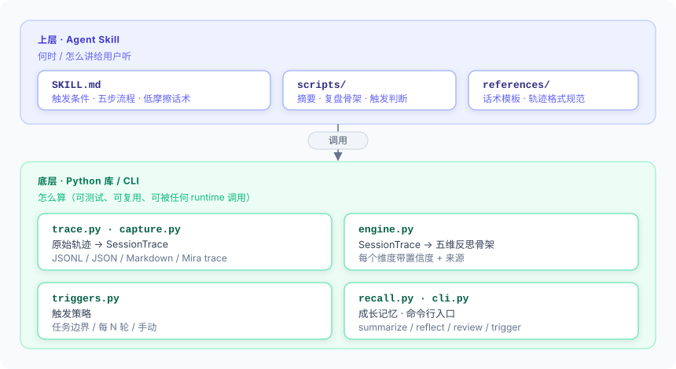
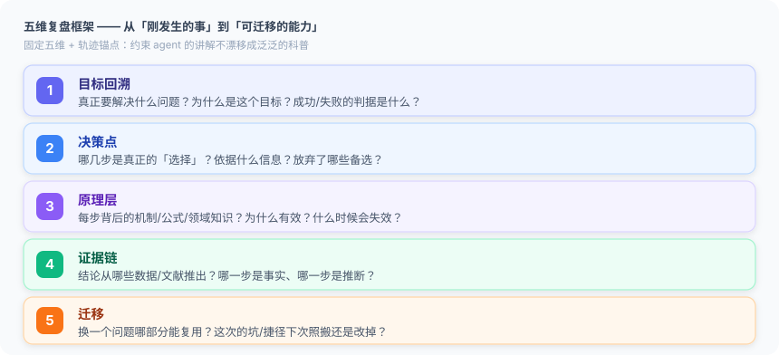
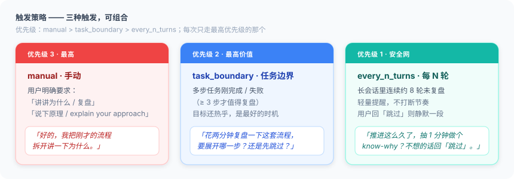

# knowWhy

> 让使用者在使用 AI 完成任务的同时，**周期性复盘「为什么每一步这样做」**，
> 把认知外包变成能力增长。

[](#安装)
[](#安装)
[](#license)
[](#作为-agent-skill-使用)



## 问题

AI / Agent / LLM 能完成越来越多使用者自己做不到的事。但结果拿到手之后，
使用者自身往往没有变强——这是**认知外包（cognitive offloading）**：
AI 交付的是 *what*，使用者需要的是 *why*。

knowWhy 在做完一个任务后插入一个**低摩擦的反思回合**，把刚刚真实发生的流程
拆成结构化的因果链，并把可迁移的经验沉淀到跨会话的成长记忆里。

## 核心纪律

反思对象永远是**本次任务里真实发生的事**，不是泛泛的科普。
任何解释都要能指回具体的 `step N` / 工具名 / 参数，并区分「事实」与「推断」。

## 架构



- **上层 · Agent Skill**：承载「何时触发、怎么讲给用户听」——SKILL.md、话术模板、
  低摩擦交互。
- **底层 · Python 库 / CLI**：承载「怎么算」——轨迹归一化、五维反思引擎、触发策略、
  成长记忆。可测试、可复用、可被任何 runtime 调用。

设计取向上，**Skill 是主体，库是它的手脚**：方法论才是可迁移的资产（见「设计取舍」）。

## 安装

```bash
pip install .          # 提供 `knowwhy` 命令
python -m pytest -q    # 46 项自测
```

## 快速上手（CLI）

```bash
# 0. 把运行环境里的真实轨迹转成规范轨迹（无需手写 JSONL）
knowwhy capture examples/real/mira_trace_raw.json -o session.json

# 1. 把会话轨迹压成紧凑摘要，喂给反思
knowwhy summarize examples/demo_session.jsonl

# 2. 生成五维复盘（Markdown / JSON；可只展开一个维度）
knowwhy reflect examples/demo_session.jsonl
knowwhy reflect examples/demo_session.jsonl --focus decisions --json

# 3. 触发策略：现在该不该复盘？
knowwhy trigger --state .knowwhy/state.json --task-ended --n-steps 6 --turn 12

# 4. 周期性成长回顾
knowwhy review --store .knowwhy/growth.jsonl
```

## 轨迹从哪来

框架对「已有轨迹」做反思，所以真实使用时的第一步是把运行环境的记录接进来。
目前的采集适配器支持 **Mira / sciClaw 本地轨迹**：

```bash
# 列出某次会话的所有 trace
curl -H "Authorization: Bearer <token>" \
  http://127.0.0.1:62621/api/v1/traces/by-session/<session_id>
# 取单条 trace，然后交给 capture
curl -H "Authorization: Bearer <token>" \
  http://127.0.0.1:62621/api/v1/traces/<trace_id> -o trace.json
knowwhy capture trace.json -o session.json && knowwhy reflect session.json
```

`capture` 做三件关键的事：保留每个工具调用与参数；**区分真实失败**（shell 命令因退出码
非零而被标 false，但只要有输出且无错误信息就不算失败）；从可观察线索（失败后的转向、
原样重试、首次引入新能力）推断出**候选决策点**——注意它给的是线索而非理由，理由仍由
agent 结合上下文补全。见 `examples/real/` 里的真实样例。

## 快速上手（库）

```python
from knowwhy import load_trace, summarize_trace, build_reflection

trace = load_trace("session.jsonl")
print(summarize_trace(trace))                 # 紧凑摘要
print(build_reflection(trace).to_markdown())  # 五维复盘
```

## 五维复盘框架



每个维度都带**置信度 + 来源**：反思本身也会幻觉，所以轨迹里观察到的事实与推断
必须分开标注，避免用错误知识训练使用者。

## 触发策略（周期性）



三种触发可组合，**优先级 `manual > task_boundary > every_n_turns`**，每次只走最高
优先级的那个：

- **任务边界**：多步任务刚完成/失败（≥3 步）→ 主动复盘邀请（价值最高的时机，目标还热乎）；
- **每 N 轮**：长会话里连续约 8 轮未复盘 → 轻量提醒（可「跳过」静默，不反复打扰）；
- **手动**：用户说「讲讲为什么 / 复盘 / explain your approach」→ 立即展开，不啰嗦。

为什么要三种而不是一个定时器？固定时钟会在没事发生时打扰、在最该复盘的硬任务后沉默。
用**事件锚点 + 粗粒度节奏上限**，才能在正确的时刻出现。

## 作为 Agent Skill 使用

`skill/knowwhy/` 是符合 agent-skill 规范的可安装 skill（已通过 skill-creator
校验并打包为 `knowwhy.skill`）。把它放进你的 agent 的 skills 目录即可；
它会在任务边界自动触发，并调用 `scripts/summarize_trace.py` 生成摘要与复盘骨架。

```bash
# 重新打包（改了 skill 之后）
python -m scripts.package_skill skill/knowwhy   # 需要 skill-creator 的脚本
```


## 设计取舍

- **为什么 skill + 库，而不是二选一**：库承载「怎么算」（可测试、可复用、可被任何
  runtime 调用），Skill 承载「何时触发、怎么讲给用户听」。方法论才是可迁移资产，
  所以 Skill 是主体，库是它的手脚。
- **为什么骨架先行**：无结构地让 LLM「解释一下」，会漂移成无关的教科书段落。
  用固定五维 + 轨迹锚点约束它，才能保证反思扣住本次任务。
- **为什么标置信度**：反思本身也会幻觉，区分 fact / inference，避免用错误知识
  训练使用者。
- **为什么采集而不是让用户手写轨迹**：没人会手写轨迹。把运行环境的真实记录接进来
  （`capture`），并如实指出「哪一步值得追问」而不是编造理由，才是可用的起点。

## 目录结构

```
knowWhy/
├── knowwhy/            # Python 库（trace / capture / engine / triggers / recall / cli）
├── templates/          # 通用五维话术模板
├── examples/           # 示例轨迹
│   ├── demo_session.jsonl / demo_conclusion.md   # 教学示例
│   └── real/           # 真实 Mira 轨迹（原始 + 规范化）
├── docs/assets/        # README 用的架构 / 数据流 / 五维 / 触发 示意图（SVG）
├── tests/              # pytest 自测（库 23 + capture 18 + Skill 脚本 5）
├── skill/knowwhy/      # 可安装 Agent Skill
│   ├── SKILL.md
│   ├── README.md
│   ├── scripts/summarize_trace.py
│   └── references/     # 话术模板 + 轨迹格式规范
├── knowwhy.skill       # 打包好的可安装 skill 文件
├── pyproject.toml
└── README.md
```

## License

MIT
